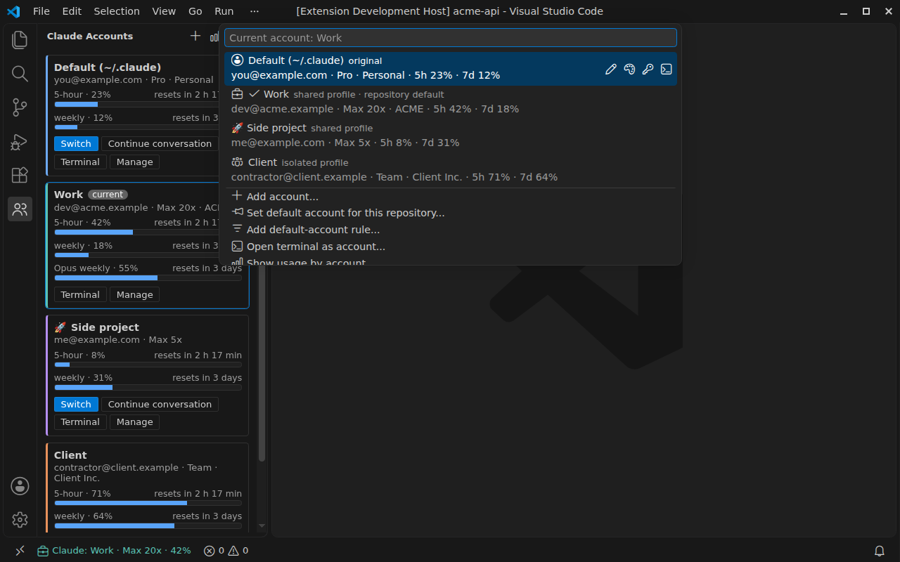
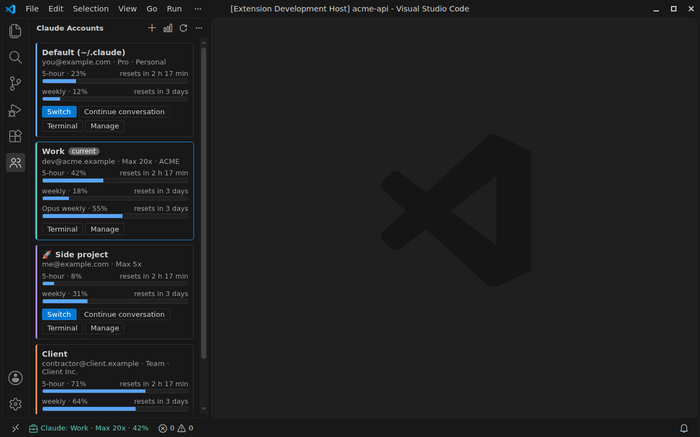
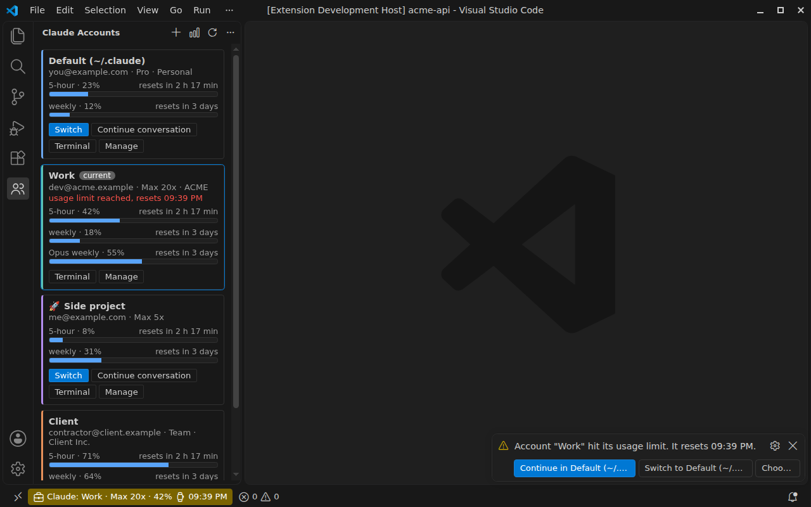

# Multi-Account Switcher for Claude Code

[](https://marketplace.visualstudio.com/items?itemName=kahuecosta.claude-code-multi-account)
[](https://marketplace.visualstudio.com/items?itemName=kahuecosta.claude-code-multi-account)
[](https://marketplace.visualstudio.com/items?itemName=kahuecosta.claude-code-multi-account&ssr=false#review-details)
[](https://open-vsx.org/extension/kahuecosta/claude-code-multi-account)
[](https://github.com/Kahuecosta/account-switcher-for-claude-code/actions/workflows/ci.yml)
[](https://scorecard.dev/viewer/?uri=github.com/Kahuecosta/account-switcher-for-claude-code)
[](LICENSE)

Use several Claude Code accounts in VS Code at the same time: a different account **per window or per repository**, every account's **plan and 5-hour and weekly limits** at a glance, and **one click to continue the conversation in another account** when one hits its limit, without reloading the window. Your `~/.claude` folder is never deleted or overwritten.


> **Not affiliated with Anthropic.** This is a community extension. "Claude" and "Claude Code" are trademarks of Anthropic, PBC.

[Português (Brasil)](README.pt-BR.md)

## Features

**Switching**

- **No reload**: switching changes the Claude Code panel's account and its new chats right away, with recent versions of the Claude Code extension (checked automatically). Conversations already open keep their account until you close them.
- **Per-window accounts**: each VS Code window can use a different account at the same time.
- **Per-repository defaults**: open a repository and its account is applied before Claude Code starts. Clones of the same repository share the default, because it is keyed by the git remote.
- **Rules**: every repository under `~/work/**`, or every repository of `github.com/my-company/*`, uses a given account.
- **Quick toggle** between the last two accounts with `Ctrl+Alt+Shift+A` (`Cmd+Alt+Shift+A` on macOS), the status bar, or the **Claude Accounts** view in the Activity Bar (also as a list in the Explorer).
- **Per-chat accounts** (experimental, macOS, Linux and WSL): open a new Claude Code chat as any account without reloading the window; a resumed conversation uses the account it belongs to.
- **Terminals**: the `claude` CLI in integrated terminals uses the same account as the panel, and **Open terminal as account** runs the CLI as any other account without switching the window.

**Knowing where you are**

- The **Claude Accounts** view in the Activity Bar has a card per account: e-mail, plan, 5-hour and weekly bars with their reset times, and buttons to switch, continue the conversation there or open a terminal.
- Each account shows its **e-mail, plan** (e.g. Pro, Max 20x) and **organization**, plus its own **color and icon or emoji** in the status bar, and an optional image in the picker.
- The status bar shows when the Claude Code panel still uses the previous account until the window reloads (when switching without a reload is off or not possible).
- **Diagnose** writes a report of which account each part of VS Code uses and runs `claude auth status` for every account.

**Usage limits**

- The **5-hour and weekly usage** of every account, plus per-model weekly limits and extra usage when your plan has them, read from what Claude Code saves for each account, which the extension has it check every few minutes: no setup, and none of your plan is used.
- When the current account hits its usage limit, or crosses `claudeAccounts.quotaThreshold`, the extension offers to **continue the conversation in the account with the most quota left** (it opens in a new tab as that account), or just to switch to it, and tells you when the limit resets. With `claudeAccounts.onUsageLimit: switch` it does this on its own: at the limit the conversation goes along; near it, only the window switches, since the conversation may still be working.
- **Continue latest conversation with another account** works at any time, with or without shared history, in the panel or in a terminal.
- **Usage by account**: tokens used today and in the last 7 days, from Claude Code's local logs.

**Profiles and history**

- **Shared profile**: reuses the settings, `CLAUDE.md`, agents, commands, skills, rules, plugins and user-scope MCP servers of `~/.claude`, and keeps only its own login. **Isolated profile**: everything separate.
- **Optional shared history**: every account sees the same conversations. Turning it on merges the history each account already has; every change is journaled and rolled back if anything fails.

**Account types**

- Claude subscription (claude.ai login), long-lived subscription token (`claude setup-token`), Anthropic API key, Amazon Bedrock and Google Vertex AI. Keys and tokens are kept in VS Code's secret storage.

**Safe by design**

- Your original `~/.claude` is the **Default** account and is never deleted or overwritten. Login data is never linked between accounts, whatever the settings say.
- No telemetry. No network access, except Gravatar if you turn it on.
- Settings Sync carries names, colors, icons and repository defaults to your other machines; folders, logins and environment variables stay local.

## Screenshots

| Account picker | Claude Accounts view and status bar | Usage limit reached |
| --- | --- | --- |
| [](images/screenshots/account-picker.png) | [](images/screenshots/accounts-view.png) | [](images/screenshots/usage-limit.png) |

_Demo data. Regenerate with `npm run screenshots`._

## Install

- **VS Code**: install [Multi-Account Switcher for Claude Code](https://marketplace.visualstudio.com/items?itemName=kahuecosta.claude-code-multi-account) from the Marketplace.
- **Cursor, VSCodium, Windsurf** and other editors that use Open VSX: install it from [Open VSX](https://open-vsx.org/extension/kahuecosta/claude-code-multi-account).
- **Manually**: download the `.vsix` from [GitHub Releases](https://github.com/Kahuecosta/account-switcher-for-claude-code/releases) and run **Extensions: Install from VSIX…**. Every release has a `SHA256SUMS.txt` and a build provenance attestation you can check with `gh attestation verify <file>.vsix --repo Kahuecosta/account-switcher-for-claude-code`.

Requires VS Code 1.85 or later. It works with the official [Claude Code extension](https://marketplace.visualstudio.com/items?itemName=anthropic.claude-code) and with the `claude` CLI alone.

## Getting started

1. Click **Claude: default** in the status bar and choose **Add account…** (or run the **Get started with multiple Claude Code accounts** walkthrough).
2. Give it a name, choose how it signs in, and pick **Shared** or **Isolated** profile.
3. Choose **Log in**. A terminal opens with only that account's environment and runs `claude auth login` (with the CLI bundled in the Claude Code extension when `claude` is not on your PATH). The extension notices when the login is done.
4. Switch accounts from the status bar at any time. The Claude Code panel follows right away; with an older Claude Code, the window reloads instead.
5. Optional: **Set default account for this repository…** or **Add default-account rule…**.

Run `/status` in Claude Code, or **Claude Accounts: Diagnose**, to confirm which account is active.

## How it works

Claude Code reads its configuration folder from the `CLAUDE_CONFIG_DIR` environment variable. Each account is a folder under `~/.claude-accounts/` by default. When a window starts, the extension sets `CLAUDE_CONFIG_DIR` (and the account's own variables) in that window's extension host, synchronously, before the Claude Code extension starts its CLI. Integrated terminals get the same variables through VS Code's environment-variable API; terminals opened for another account get a complete environment of their own instead.

**Switching without a reload.** The Claude Code extension starts every `claude` process with the extension host's environment, read again at each start, so new chats follow `CLAUDE_CONFIG_DIR` as soon as it changes. Its account display, sign-in state and caches follow too once it re-checks `CLAUDE_CONFIG_DIR`, which it does whenever `claudeCode.environmentVariables` changes. So after a switch the extension adds an entry to that setting and removes it right away; the setting ends exactly as it was, and in the other windows Claude Code finds nothing changed. Before doing this, the extension checks that the installed Claude Code contains that behavior (recent versions do); otherwise, or with `claudeAccounts.switchWithoutReload` off, the window reloads as before and the status bar shows a sync icon until then. A test against the real Claude Code extension runs every week in CI to notice a release that changes it.

Conversations already open keep their `claude` process, and so their account, until they are closed: a running process cannot change accounts. **Continue in…** therefore opens the conversation in a new tab, from a copy with a new session id (like Claude Code's own `--fork-session`); the tab you were using is left as it was.

Shared items are symbolic links. On Windows, folders use junctions, which need no admin rights, and files use a symlink or, as a fallback, a hard link. The repository is identified by reading `.git` directly; no `git` process is started, so this is safe in untrusted folders.

## Usage limits and quota

**Usage of every account.** Whenever Claude Code checks an account's usage, it saves the answer in that account's `.claude.json`. The extension reads it (only when the file changed) and shows the 5-hour and weekly windows, per-model weekly limits and extra usage in the status bar, the picker and the **Claude Accounts** view. Claude Code checks it when its panel starts and when you ask for `/usage`, but not while a conversation goes on, so the extension also has it check: every 5 minutes while you use the window (`claudeAccounts.usageCheckMinutes`) and when you refresh the view. For that it starts the `claude` binary as each account for a few seconds, with no hooks, tools or MCP servers, asks for the usage and sends no message, so none of the plan is used and no conversation is left behind. An answer saved for a different login than the one now in the folder is ignored, and a reading older than 15 minutes says when it is from.

**Hitting a limit.** The extension watches this window's session logs (in the account's `projects/` folder). When Claude Code reports a usage limit, or a reading of the last 15 minutes crosses `claudeAccounts.quotaThreshold` (95% by default), it records the limit for every window, offers the best other account (signed in, not limited, lowest usage), and announces when the limit resets. With extra usage turned on, the threshold still applies: another subscription with quota left comes before paid usage (set the threshold to `0` to keep using extra usage instead).

**Continuing the conversation.** **Continue in…** copies the conversation (with its subagent files and checkpoints) into the other account and switches: from the usage-limit notification, the very conversation that hit the limit; from the **Claude Accounts** view or the command, the latest conversation of this window's folders. Without a reload, the copy gets a new session id and opens in a new tab as the other account; the tab you were using keeps running as before. When the window must reload, the copy keeps its id and the conversation reopens once the window has, copied again then so messages written before the reload go too. A copy in the other account is replaced only by one that continues it; if the conversation went on in both accounts, a new copy is made instead, so no message is lost. **Continue latest conversation in terminal as account** opens a copy with a new session id in a terminal (`claude --resume`), so it never runs the same conversation as a Claude Code tab.

**Live quota** is optional (**Claude Accounts: Turn live quota on or off**) and only makes updates more frequent while the `claude` CLI runs in a terminal. Claude Code passes the `rate_limits` of Pro and Max subscriptions to its [status line](https://code.claude.com/docs/en/statusline). The extension wraps the `statusLine` command in `settings.json` with a small script (in `~/.claude-accounts/.bridge/`) that saves that input in the account folder and then runs your own status line unchanged. Turning it off restores your status line.

## Per-chat accounts (experimental)

With `claudeAccounts.perChatAccounts` on (or the first time you use **New chat as account**), the extension sets the Claude Code extension's `claudeCode.claudeProcessWrapper` to a small launcher (`~/.claude-accounts/.bridge/claude-accounts-wrapper.sh`). Claude Code starts every `claude` process through it, and the launcher only chooses `CLAUDE_CONFIG_DIR` before running `claude` with the same arguments:

- **New chat as account** opens a new Claude Code tab as that account, without reloading the window or touching the other chats.
- A **resumed conversation** (after a reload, or from the history) uses the account whose copy of it was written last. With shared history every account has the same copy, so a resumed conversation uses the window's account.
- Anything else keeps the window's account.

Only accounts that sign in with their own claude.ai login and set no environment variables of their own can be used for a single chat: the launcher can change the folder, but cannot supply a key or token. A chat routed to another account never inherits the variables of the window's account (an API key, for example). A wrapper you already had keeps running: the launcher starts it instead of `claude`. Turning the setting off restores the previous value. Only on macOS, Linux and WSL (the Claude Code extension cannot start a script on Windows).

## Rules

Rules are checked in order whenever a repository has no default of its own:

```json
"claudeAccounts.rules": [
  { "pattern": "github.com/my-company/*", "account": "work" },
  { "pattern": "~/personal/**", "account": "me@example.com" }
]
```

A pattern that starts with `~`, `/` or a drive letter is matched against the folder path. Anything else is matched against the git remote. `*` matches one segment and `**` matches any depth. A pattern without wildcards also matches everything below it. `account` accepts the account id (its folder name), its name or its e-mail.

In a window with several folders, the first folder that has a repository default wins, then the first that matches a rule; the tooltip lists folders that prefer another account.

## Automation

Bind a key to a specific account:

```json
{ "key": "ctrl+alt+1", "command": "claudeAccounts.switch", "args": "work" }
```

Every per-account command (`switch`, `login`, `openTerminal`, `rename`, `remove`…) accepts an account id, name or e-mail as its argument. Links of the form `vscode://kahuecosta.claude-code-multi-account/switch?account=work` (also `openTerminal`, `diagnose`, `add`) always ask for confirmation.

Other extensions can use the API:

```js
const api = vscode.extensions.getExtension('kahuecosta.claude-code-multi-account')?.exports;
api?.getCurrentAccount(); // { id, name, email, plan, organization, configDir, mode, kind, isDefault }
api?.onDidChangeAccount((account) => console.log(account.name));
await api?.switchAccount('work');
```

## Remote development

The extension runs where Claude Code runs: on the remote machine for Remote-SSH, WSL, Dev Containers and Codespaces. Accounts, logins and `~/.claude-accounts` live on that machine, so add and log in to accounts once per remote machine. Settings Sync still carries names, colors and repository defaults.

## Settings

<!-- settings:start -->
| Setting | Default | Description |
| --- | --- | --- |
| `claudeAccounts.scope` | `"workspace"` | Where the selected account is remembered. `workspace`: Each window/repository remembers its own account (extension storage; nothing is written to the repository). `user`: A single account for every window (each window picks it up when it gets focus). |
| `claudeAccounts.switchWithoutReload` | `true` | Switch without reloading the window when the installed Claude Code extension supports it: the panel's account and new chats change right away. Conversations already open keep their account until you close them or reload. To let Claude Code know, the extension adds an entry to `claudeCode.environmentVariables` and removes it right away. |
| `claudeAccounts.reloadBehavior` | `"ask"` | What to do after switching when the window must reload (switching without a reload is off or not possible). `ask`: Ask whether to reload the window. `always`: Reload the window right away. `never`: Do not reload; the status bar shows that a reload is pending. |
| `claudeAccounts.autoApplyRepoDefault` | `true` | When a repository is opened, automatically apply the default account set for it or matched by a rule. |
| `claudeAccounts.rules` | `[]` | Default-account rules, checked in order when no default is set for the specific repository. A pattern starting with `~`, `/` or a drive letter matches the folder path (e.g. `~/work/**`); anything else matches the git remote (e.g. `github.com/my-company/*`). Without wildcards, a pattern also matches everything below it. `account` is the account id, name or e-mail. Add a rule |
| `claudeAccounts.statusBarStyle` | `"name"` | How the current account appears in the status bar. `name`: Icon and full name, e.g. Claude: Work. `initials`: Icon and initials, e.g. WO. `icon`: Icon only (most compact). |
| `claudeAccounts.showPlan` | `true` | Show the account's plan (e.g. Pro, Max 20x) in the status bar and the account picker, when Claude Code provides it. |
| `claudeAccounts.showQuota` | `true` | Show the usage of the current limit window in the status bar. |
| `claudeAccounts.onUsageLimit` | `"suggest"` | What to do when the current account hits its usage limit in this window, or crosses claudeAccounts.quotaThreshold. `suggest`: Offer to continue the conversation in the account with the most quota left, or to switch to it. `switch`: Do it automatically: at the limit, the conversation continues in the account with the most quota left; near it, only the window switches. `ignore`: Do nothing. |
| `claudeAccounts.liveQuota` | `false` | Also read usage from Claude Code's status line input, for more frequent updates while the `claude` CLI runs in a terminal. Usage is always read from what Claude Code saves in each account's `.claude.json`; this adds a second source. The extension wraps the `statusLine` command in `settings.json` with a script that saves that input and then runs your own status line unchanged; turning this off restores it. Use Turn live quota on or off. |
| `claudeAccounts.quotaThreshold` | `95` | Treat an account as at its limit when its 5-hour or weekly usage reaches this percentage, so the switch happens before Claude Code refuses requests. `0` turns this off. |
| `claudeAccounts.usageCheckMinutes` | `5` | How often, in minutes, to have Claude Code check the plan usage of every signed-in account while you use the window, so the figures stay current. Each check starts the `claude` binary in the background for a few seconds, as that account; it sends no message, so it uses none of your plan. `0` checks only when you refresh the accounts. |
| `claudeAccounts.shareHistory` | `false` | All accounts use the same conversation history from `~/.claude`. Use Share history across accounts to turn this on or off: it merges existing history instead of discarding it. |
| `claudeAccounts.historyItems` | `projects`, `history.jsonl`, `file-history`, `todos`, `plans` | Items treated as history: per-folder conversations (projects), prompt history (history.jsonl), checkpoints (file-history), todos and plans. |
| `claudeAccounts.sharedItemsMode` | `"list"` | Which items of ~/.claude shared-profile accounts use through links. `list`: Only the items in claudeAccounts.sharedItems. `allExcept`: Every item of ~/.claude except login data, history, session state and claudeAccounts.sharedItemsExclude. New configuration folders are shared without changing settings. |
| `claudeAccounts.sharedItems` | `settings.json`, `CLAUDE.md`, `agents`, `commands`, `skills`, `hooks`, `output-styles`, `plugins`, `rules`, `workflows`, `keybindings.json`, `themes` | Items from `~/.claude` that shared-profile accounts use through links. Login data (`.credentials.json`, `.claude.json`) and session state are never shared, whatever this list says. |
| `claudeAccounts.sharedItemsExclude` | `[]` | Items never shared in the `allExcept` mode of `claudeAccounts.sharedItemsMode`. |
| `claudeAccounts.shareMcpServers` | `true` | Copy your user-scope MCP servers (from the Default account's `.claude.json`) into shared-profile accounts. Servers an account defines itself are kept. Add new servers in the Default account. |
| `claudeAccounts.perChatAccounts` | `false` | Experimental. Each Claude Code chat can use its own account without reloading the window: **New chat as account** opens a chat as any account, and a resumed conversation uses the account it belongs to. Sets `claudeCode.claudeProcessWrapper` to a small launcher (macOS, Linux and WSL only); turning this off restores the previous value. |
| `claudeAccounts.applyToTerminal` | `true` | Also set the account in this window's integrated terminals so the claude CLI uses the same account. |
| `claudeAccounts.loginCommand` | `"claude auth login"` | Command run in the terminal to log in to an account. |
| `claudeAccounts.accountsRoot` | — | Folder where accounts are created. Empty = ~/.claude-accounts. |
| `claudeAccounts.gravatar` | `false` | Show the Gravatar of each account's e-mail in the account picker. Off by default: when on, the extension requests images from gravatar.com, sending a hash of the e-mail. |
| `claudeAccounts.suggestSwitchOnLimit` | `true` | Deprecated. Replaced by `claudeAccounts.onUsageLimit`. |
<!-- settings:end -->

## Where things are stored

| What | Where | Synced |
| --- | --- | --- |
| Account folders (login, history, config) | `~/.claude-accounts/<id>/` (`claudeAccounts.accountsRoot`) | No |
| Default account | `~/.claude` and `~/.claude.json`, or the `CLAUDE_CONFIG_DIR` VS Code was launched with | No |
| Names, colors, icons, repository defaults | VS Code global storage | Settings Sync |
| Environment variables | VS Code global storage; secret values in VS Code secret storage | No |
| Selected account | VS Code workspace storage (or global, with `claudeAccounts.scope: user`) | No |
| Backups of merged history and replaced files | `~/.claude-accounts/.backups/` (last 10 operations) | No |
| Live quota bridge | `~/.claude-accounts/.bridge/` and `.multi-account-statusline.json` in each account folder | No |
| Per-chat launcher | `~/.claude-accounts/.bridge/` (`claude-accounts-wrapper.sh`, `accounts.list`, `route/`) | No |
| Log | **Claude Accounts: Show log** | No |

## Privacy and security

- **No telemetry.** The only network request the extension can make is to gravatar.com, and only if you turn on `claudeAccounts.gravatar` (it sends a SHA-256 hash of the e-mail). Usage checks (`claudeAccounts.usageCheckMinutes`) are made by Claude Code itself, with each account's own login.
- Outside its own folders, the extension changes only: `~/.claude` when you turn on shared history (each account's history is merged into it, with backups in `~/.claude-accounts/.backups/`); the `statusLine` of `settings.json` with live quota on; `claudeCode.claudeProcessWrapper` with per-chat accounts on; and, for a moment at each switch without a reload, `claudeCode.environmentVariables` (an entry added and removed). Turning live quota or per-chat accounts off restores what they changed; turning shared history off gives each account its own history again (a copy of the shared one, or empty, as you choose) and leaves the merged history in `~/.claude`.
- From the credentials file, the extension reads **only** `subscriptionType` and `rateLimitTier`. From `.claude.json` it reads only the account (`oauthAccount`: e-mail, organization, plan) and the saved usage (`cachedUsageUtilization`). Tokens are never stored, displayed or sent anywhere.
- The rating prompt appears at most twice, after a week and a few switches, and only opens the extension's page.
- Login data (`.credentials.json`, `.claude.json`) and per-session state are never shared between accounts, even if listed in `claudeAccounts.sharedItems`.
- Settings that change what happens to your folders or to Claude Code's settings (`shareHistory`, `rules`, `scope`, `liveQuota`, `switchWithoutReload`, `perChatAccounts`…) can only be set in user settings, never by a repository's `.vscode/settings.json`. In Restricted Mode, workspace settings cannot change when accounts are applied.
- Report vulnerabilities privately; see [SECURITY.md](SECURITY.md).

## Troubleshooting

- **The panel shows the wrong account right after startup**: the Claude Code panel was restored before this extension activated. The extension tells it about the account right away; conversations it had already started keep the launch account until you close them. With an older Claude Code, reload the window once; the status bar shows a sync icon when this is needed.
- **Every window uses the same account**: `CLAUDE_CONFIG_DIR` is set in `claudeCode.environmentVariables`. That setting applies to every window; the extension detects it and offers to remove only that entry.
- **macOS**: credentials are kept in the Keychain, one entry per account folder. **Diagnose** runs `claude auth status` for each account to confirm the logins are separate.
- **A shared item stopped syncing**: a tool replaced the link with a copy. The extension detects this and offers **Relink**, keeping the local version as `.bak-<date>`.
- **Chats from one account don't show up in another**: shared profiles and **Relink** share configuration only; each account keeps its own history. Run **Claude Accounts: Share / stop sharing history across accounts** to share conversations, then reload the window. The Claude Code panel lists past conversations from the account's `projects` folder, which history sharing links.
- **The window still reloads when switching**: **Diagnose** says why under "Switch without reloading": `claudeAccounts.switchWithoutReload` is off, `CLAUDE_CONFIG_DIR` is set in `claudeCode.environmentVariables`, or the installed Claude Code does not support it (update it).
- **An open conversation still uses the previous account**: a running conversation keeps its account. Close its tab and open it again from the history (with shared history), use **Continue in…**, or reload the window to move every open conversation.
- **No usage figures for an account**: they appear once Claude Code has checked that account's usage. Refresh the **Claude Accounts** view; if that account cannot be checked, the log says why.
- Anything else: run **Claude Accounts: Diagnose**, check **Claude Accounts: Show log**, and [open an issue](https://github.com/Kahuecosta/account-switcher-for-claude-code/issues/new/choose) with the report (e-mails are masked).

## Known limitations

- A conversation that is already open keeps its account until its tab is closed or the window reloads; switching affects the panel's account and new chats.
- Switching without a reload briefly adds an entry to `claudeCode.environmentVariables` in your user settings and removes it again, keeping any change made to that setting meanwhile.
- Per-chat accounts are experimental: **New chat as account** applies to the next new chat the panel starts in that window within 30 seconds (if Claude Code starts another new `claude` process first, that one gets the account); the panel's own account display keeps the window's account; and with a process wrapper set, Claude Code starts new chats in the default permission mode unless you choose another.
- Usage figures are as fresh as Claude Code's last check of each account: about `claudeAccounts.usageCheckMinutes` minutes old at most while you use the window.
- Per-account environment variables apply to every extension of a window that uses the account.
- Your own hooks or scripts that hard-code `~/.claude` keep pointing at the Default account. Use `$CLAUDE_CONFIG_DIR` in them instead.
- Token counts (**Show usage by account**) come from this machine's logs only, and cannot be split by account while history is shared.
- The transcript and credential formats are internal to Claude Code and may change; every field is read defensively.

## Uninstalling

1. Turn off live quota and per-chat accounts first, if you turned them on, so your own status line and `claudeCode.claudeProcessWrapper` are restored.
2. Optional: turn off shared history to give each account its own copy again.
3. Uninstall the extension. `~/.claude` is untouched; account folders stay in `~/.claude-accounts/` until you delete them.

## Contributing

Contributions are welcome. See [CONTRIBUTING.md](CONTRIBUTING.md) for the development setup, tests and translations, and [docs/ARCHITECTURE.md](docs/ARCHITECTURE.md) for how the code is organized.

## License

[MIT](LICENSE)
