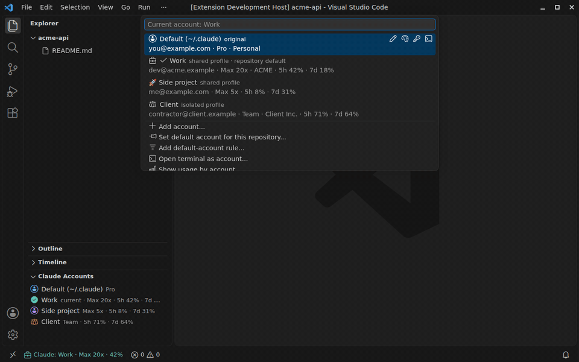
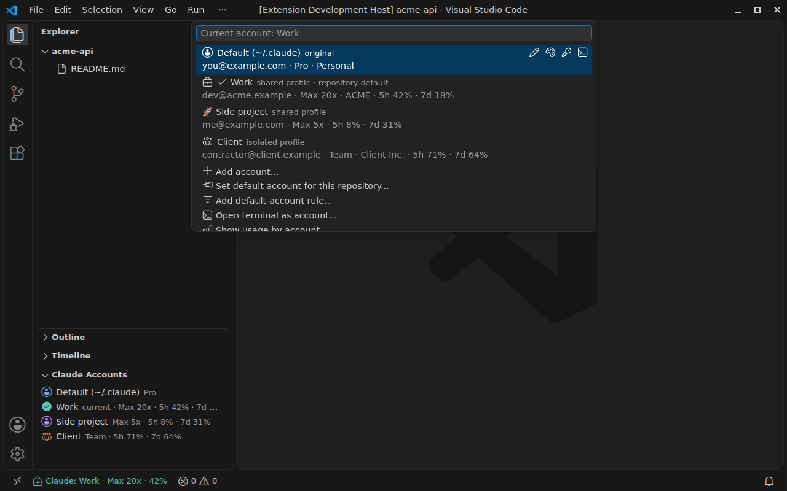
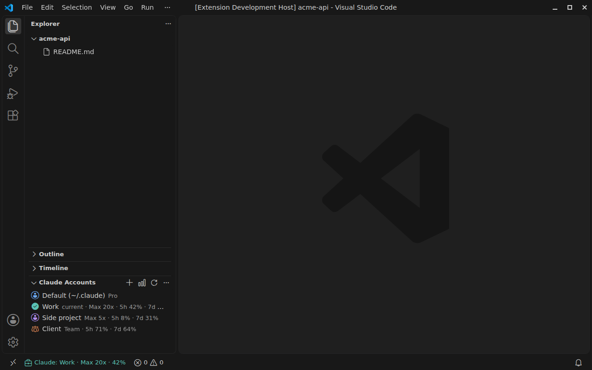
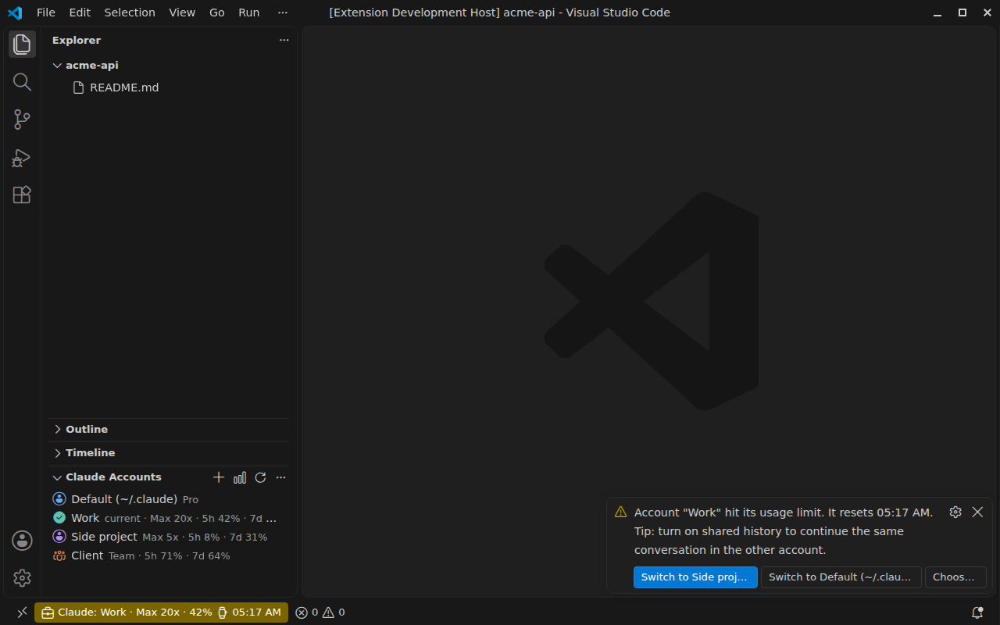

# Multi-Account Switcher for Claude Code

[](https://marketplace.visualstudio.com/items?itemName=kahuecosta.claude-code-multi-account)
[](https://marketplace.visualstudio.com/items?itemName=kahuecosta.claude-code-multi-account)
[](https://marketplace.visualstudio.com/items?itemName=kahuecosta.claude-code-multi-account&ssr=false#review-details)
[](https://open-vsx.org/extension/kahuecosta/claude-code-multi-account)
[](https://github.com/Kahuecosta/account-switcher-for-claude-code/actions/workflows/ci.yml)
[](https://scorecard.dev/viewer/?uri=github.com/Kahuecosta/account-switcher-for-claude-code)
[](LICENSE)

Use several Claude Code accounts in VS Code at the same time: a different account **per window or per repository**, each account's **plan and usage limits** at a glance, and a **one-click move to another account** when one hits its limit. Your `~/.claude` folder is never modified.



> **Not affiliated with Anthropic.** This is a community extension. "Claude" and "Claude Code" are trademarks of Anthropic, PBC.

[Português (Brasil)](README.pt-BR.md)

## Features

**Switching**

- **Per-window accounts**: each VS Code window can use a different account at the same time.
- **Per-repository defaults**: open a repository and its account is applied before Claude Code starts. Clones of the same repository share the default, because it is keyed by the git remote.
- **Rules**: every repository under `~/work/**`, or every repository of `github.com/my-company/*`, uses a given account.
- **Quick toggle** between the last two accounts with `Ctrl+Alt+Shift+A` (`Cmd+Alt+Shift+A` on macOS), the status bar, or the **Claude Accounts** view in the Explorer.
- **Terminals**: the `claude` CLI in integrated terminals uses the same account as the panel, and **Open terminal as account** runs the CLI as any other account without switching the window.

**Knowing where you are**

- Each account shows its **e-mail, plan** (e.g. Pro, Max 20x) and **organization**, plus its own **color and icon or emoji** in the status bar, and an optional image in the picker.
- The status bar shows when the Claude Code panel still uses the previous account until the window reloads.
- **Diagnose** writes a report of which account each part of VS Code uses and runs `claude auth status` for every account.

**Usage limits**

- When the current account hits its usage limit, the extension offers the account with the **most quota left**, or switches on its own (`claudeAccounts.onUsageLimit`), and tells you when the limit resets.
- **Live quota** (opt-in) shows the **5-hour and weekly usage** of every account, read from Claude Code's own status line data, and can switch **before** the limit is hit.
- With shared history, **continue the same conversation** in the other account (`claude --continue`).
- **Usage by account**: tokens used today and in the last 7 days, from Claude Code's local logs.

**Profiles and history**

- **Shared profile**: reuses the settings, `CLAUDE.md`, agents, commands, skills, rules, plugins and user-scope MCP servers of `~/.claude`, and keeps only its own login. **Isolated profile**: everything separate.
- **Optional shared history**: every account sees the same conversations. Turning it on merges the history each account already has; every change is journaled and rolled back if anything fails.

**Account types**

- Claude subscription (claude.ai login), long-lived subscription token (`claude setup-token`), Anthropic API key, Amazon Bedrock and Google Vertex AI. Keys and tokens are kept in VS Code's secret storage.

**Safe by design**

- Your original `~/.claude` is the **Default** account and is never deleted or overwritten. Login data is never linked between accounts, whatever the settings say.
- No telemetry. No network access, except Gravatar if you turn it on.
- Settings Sync carries names, colors, icons and repository defaults to your other machines; folders, logins and environment variables stay local.

## Screenshots

| Account picker | Explorer view and status bar | Usage limit reached |
| --- | --- | --- |
| [](images/screenshots/account-picker.png) | [](images/screenshots/accounts-view.png) | [](images/screenshots/usage-limit.png) |

_Demo data. Regenerate with `npm run screenshots`._

## Install

- **VS Code**: install [Multi-Account Switcher for Claude Code](https://marketplace.visualstudio.com/items?itemName=kahuecosta.claude-code-multi-account) from the Marketplace.
- **Cursor, VSCodium, Windsurf** and other editors that use Open VSX: install it from [Open VSX](https://open-vsx.org/extension/kahuecosta/claude-code-multi-account).
- **Manually**: download the `.vsix` from [GitHub Releases](https://github.com/Kahuecosta/account-switcher-for-claude-code/releases) and run **Extensions: Install from VSIX…**. Every release has a `SHA256SUMS.txt` and a build provenance attestation you can check with `gh attestation verify <file>.vsix --repo Kahuecosta/account-switcher-for-claude-code`.

Requires VS Code 1.85 or later. It works with the official [Claude Code extension](https://marketplace.visualstudio.com/items?itemName=anthropic.claude-code) and with the `claude` CLI alone.

## Getting started

1. Click **Claude: default** in the status bar and choose **Add account…** (or run the **Get started with multiple Claude Code accounts** walkthrough).
2. Give it a name, choose how it signs in, and pick **Shared** or **Isolated** profile.
3. Choose **Log in**. A terminal opens with only that account's environment and runs `claude auth login`.
4. Switch accounts from the status bar at any time. The window reloads so the Claude Code panel picks up the change.
5. Optional: **Set default account for this repository…** or **Add default-account rule…**.

Run `/status` in Claude Code, or **Claude Accounts: Diagnose**, to confirm which account is active.

## How it works

Claude Code reads its configuration folder from the `CLAUDE_CONFIG_DIR` environment variable. Each account is a folder under `~/.claude-accounts/` by default. When a window starts, the extension sets `CLAUDE_CONFIG_DIR` (and the account's own variables) in that window's extension host, synchronously, before the Claude Code extension starts its CLI. Integrated terminals get the same variables through VS Code's environment-variable API; terminals opened for another account get a complete environment of their own instead.

The Claude Code extension reads the account when the window loads and has no command to restart its session, so a switch needs a window reload. The status bar shows a sync icon until then.

Shared items are symbolic links. On Windows, folders use junctions, which need no admin rights, and files use a symlink or, as a fallback, a hard link. The repository is identified by reading `.git` directly; no `git` process is started, so this is safe in untrusted folders.

## Usage limits and live quota

The extension watches this window's session logs (in the account's `projects/` folder). When Claude Code reports a usage limit, it records it for every window, offers the best other account (signed in, not limited, lowest usage), and announces when the limit resets.

**Live quota** is opt-in (**Claude Accounts: Turn live quota on or off**). Claude Code passes the `rate_limits` of Pro and Max subscriptions to its [status line](https://code.claude.com/docs/en/statusline). The extension wraps the `statusLine` command in `settings.json` with a small script (in `~/.claude-accounts/.bridge/`) that saves that input in the account folder and then runs your own status line unchanged. Turning it off restores your status line. Quota appears after the `claude` CLI shows its status line, for example in a terminal. With `claudeAccounts.quotaThreshold` (95% by default) the extension treats an account as at its limit before Claude Code starts refusing requests.

## Rules

Rules are checked in order whenever a repository has no default of its own:

```json
"claudeAccounts.rules": [
  { "pattern": "github.com/my-company/*", "account": "work" },
  { "pattern": "~/personal/**", "account": "me@example.com" }
]
```

A pattern that starts with `~`, `/` or a drive letter is matched against the folder path. Anything else is matched against the git remote. `*` matches one segment and `**` matches any depth. A pattern without wildcards also matches everything below it. `account` accepts the account id (its folder name), its name or its e-mail.

In a window with several folders, the first folder that has a repository default wins, then the first that matches a rule; the tooltip lists folders that prefer another account.

## Automation

Bind a key to a specific account:

```json
{ "key": "ctrl+alt+1", "command": "claudeAccounts.switch", "args": "work" }
```

Every per-account command (`switch`, `login`, `openTerminal`, `rename`, `remove`…) accepts an account id, name or e-mail as its argument. Links of the form `vscode://kahuecosta.claude-code-multi-account/switch?account=work` (also `openTerminal`, `diagnose`, `add`) always ask for confirmation.

Other extensions can use the API:

```js
const api = vscode.extensions.getExtension('kahuecosta.claude-code-multi-account')?.exports;
api?.getCurrentAccount(); // { id, name, email, plan, organization, configDir, mode, kind, isDefault }
api?.onDidChangeAccount((account) => console.log(account.name));
await api?.switchAccount('work');
```

## Remote development

The extension runs where Claude Code runs: on the remote machine for Remote-SSH, WSL, Dev Containers and Codespaces. Accounts, logins and `~/.claude-accounts` live on that machine, so add and log in to accounts once per remote machine. Settings Sync still carries names, colors and repository defaults.

## Settings

<!-- settings:start -->
| Setting | Default | Description |
| --- | --- | --- |
| `claudeAccounts.scope` | `"workspace"` | Where the selected account is remembered. `workspace`: Each window/repository remembers its own account (extension storage; nothing is written to the repository). `user`: A single account for every window (each window picks it up when reloaded). |
| `claudeAccounts.reloadBehavior` | `"ask"` | What to do after switching accounts. The Claude Code extension only reads the account when the window loads. `ask`: Ask whether to reload the window. `always`: Reload the window right away. `never`: Do not reload; the status bar shows that a reload is pending. |
| `claudeAccounts.autoApplyRepoDefault` | `true` | When a repository is opened, automatically apply the default account set for it or matched by a rule. |
| `claudeAccounts.rules` | `[]` | Default-account rules, checked in order when no default is set for the specific repository. A pattern starting with `~`, `/` or a drive letter matches the folder path (e.g. `~/work/**`); anything else matches the git remote (e.g. `github.com/my-company/*`). Without wildcards, a pattern also matches everything below it. `account` is the account id, name or e-mail. Add a rule |
| `claudeAccounts.statusBarStyle` | `"name"` | How the current account appears in the status bar. `name`: Icon and full name, e.g. Claude: Work. `initials`: Icon and initials, e.g. WO. `icon`: Icon only (most compact). |
| `claudeAccounts.showPlan` | `true` | Show the account's plan (e.g. Pro, Max 20x) in the status bar and the account picker, when Claude Code provides it. |
| `claudeAccounts.showQuota` | `true` | Show the usage of the current limit window in the status bar, when live quota is on. |
| `claudeAccounts.onUsageLimit` | `"suggest"` | What to do when the current account hits its usage limit in this window. `suggest`: Offer to switch to the account with the most quota left. `switch`: Switch to the account with the most quota left automatically. `ignore`: Do nothing. |
| `claudeAccounts.liveQuota` | `false` | Read each account's 5-hour and weekly usage from Claude Code's status line input. The extension wraps the `statusLine` command in `settings.json` with a script that saves that input and then runs your own status line unchanged; turning this off restores it. Use Turn live quota on or off. |
| `claudeAccounts.quotaThreshold` | `95` | With live quota on, treat an account as at its limit when the 5-hour or weekly usage reaches this percentage, so the switch happens before Claude Code refuses requests. `0` turns this off. |
| `claudeAccounts.shareHistory` | `false` | All accounts use the same conversation history from `~/.claude`. Use Share history across accounts to turn this on or off: it merges existing history instead of discarding it. |
| `claudeAccounts.historyItems` | `projects`, `history.jsonl`, `file-history`, `todos`, `plans` | Items treated as history: per-folder conversations (projects), prompt history (history.jsonl), checkpoints (file-history), todos and plans. |
| `claudeAccounts.sharedItemsMode` | `"list"` | Which items of ~/.claude shared-profile accounts use through links. `list`: Only the items in claudeAccounts.sharedItems. `allExcept`: Every item of ~/.claude except login data, history, session state and claudeAccounts.sharedItemsExclude. New configuration folders are shared without changing settings. |
| `claudeAccounts.sharedItems` | `settings.json`, `CLAUDE.md`, `agents`, `commands`, `skills`, `hooks`, `output-styles`, `plugins`, `rules`, `workflows`, `keybindings.json`, `themes` | Items from `~/.claude` that shared-profile accounts use through links. Login data (`.credentials.json`, `.claude.json`) and session state are never shared, whatever this list says. |
| `claudeAccounts.sharedItemsExclude` | `[]` | Items never shared in the `allExcept` mode of `claudeAccounts.sharedItemsMode`. |
| `claudeAccounts.shareMcpServers` | `true` | Copy your user-scope MCP servers (from the Default account's `.claude.json`) into shared-profile accounts. Servers an account defines itself are kept. Add new servers in the Default account. |
| `claudeAccounts.applyToTerminal` | `true` | Also set the account in this window's integrated terminals so the claude CLI uses the same account. |
| `claudeAccounts.loginCommand` | `"claude auth login"` | Command run in the terminal to log in to an account. |
| `claudeAccounts.accountsRoot` | — | Folder where accounts are created. Empty = ~/.claude-accounts. |
| `claudeAccounts.gravatar` | `false` | Show the Gravatar of each account's e-mail in the account picker. Off by default: when on, the extension requests images from gravatar.com, sending a hash of the e-mail. |
| `claudeAccounts.suggestSwitchOnLimit` | `true` | Deprecated. Replaced by `claudeAccounts.onUsageLimit`. |
<!-- settings:end -->

## Where things are stored

| What | Where | Synced |
| --- | --- | --- |
| Account folders (login, history, config) | `~/.claude-accounts/<id>/` (`claudeAccounts.accountsRoot`) | No |
| Default account | `~/.claude` and `~/.claude.json`, or the `CLAUDE_CONFIG_DIR` VS Code was launched with | No |
| Names, colors, icons, repository defaults | VS Code global storage | Settings Sync |
| Environment variables | VS Code global storage; secret values in VS Code secret storage | No |
| Selected account | VS Code workspace storage (or global, with `claudeAccounts.scope: user`) | No |
| Backups of merged history and replaced files | `~/.claude-accounts/.backups/` (last 10 operations) | No |
| Live quota bridge | `~/.claude-accounts/.bridge/` and `.multi-account-statusline.json` in each account folder | No |
| Log | **Claude Accounts: Show log** | No |

## Privacy and security

- **No telemetry.** The only network request the extension can make is to gravatar.com, and only if you turn on `claudeAccounts.gravatar` (it sends a SHA-256 hash of the e-mail).
- From the credentials file, the extension reads **only** `subscriptionType` and `rateLimitTier`. Tokens are never stored, displayed or sent anywhere.
- Login data (`.credentials.json`, `.claude.json`) and per-session state are never shared between accounts, even if listed in `claudeAccounts.sharedItems`.
- Settings that change what happens to your folders (`shareHistory`, `rules`, `scope`, `liveQuota`…) can only be set in user settings, never by a repository's `.vscode/settings.json`. In Restricted Mode, workspace settings cannot change when accounts are applied.
- Report vulnerabilities privately; see [SECURITY.md](SECURITY.md).

## Troubleshooting

- **The panel shows the wrong account right after startup**: the Claude Code panel was restored before this extension activated. Reload the window once; the status bar shows a sync icon when this is needed.
- **Every window uses the same account**: `CLAUDE_CONFIG_DIR` is set in `claudeCode.environmentVariables`. That setting applies to every window; the extension detects it and offers to remove only that entry.
- **macOS**: credentials are kept in the Keychain, one entry per account folder. **Diagnose** runs `claude auth status` for each account to confirm the logins are separate.
- **A shared item stopped syncing**: a tool replaced the link with a copy. The extension detects this and offers **Relink**, keeping the local version as `.bak-<date>`.
- Anything else: run **Claude Accounts: Diagnose**, check **Claude Accounts: Show log**, and [open an issue](https://github.com/Kahuecosta/account-switcher-for-claude-code/issues/new/choose) with the report (e-mails are masked).

## Known limitations

- Switching needs a window reload for the Claude Code panel (terminals switch immediately).
- Per-account environment variables apply to every extension of a window that uses the account.
- Your own hooks or scripts that hard-code `~/.claude` keep pointing at the Default account. Use `$CLAUDE_CONFIG_DIR` in them instead.
- Usage figures come from this machine's logs only, and cannot be split by account while history is shared.
- The transcript and credential formats are internal to Claude Code and may change; every field is read defensively.

## Uninstalling

1. Turn off live quota first, if you turned it on, so your own status line is restored.
2. Optional: turn off shared history to give each account its own copy again.
3. Uninstall the extension. `~/.claude` is untouched; account folders stay in `~/.claude-accounts/` until you delete them.

## Contributing

Contributions are welcome. See [CONTRIBUTING.md](CONTRIBUTING.md) for the development setup, tests and translations, and [docs/ARCHITECTURE.md](docs/ARCHITECTURE.md) for how the code is organized.

## License

[MIT](LICENSE)
