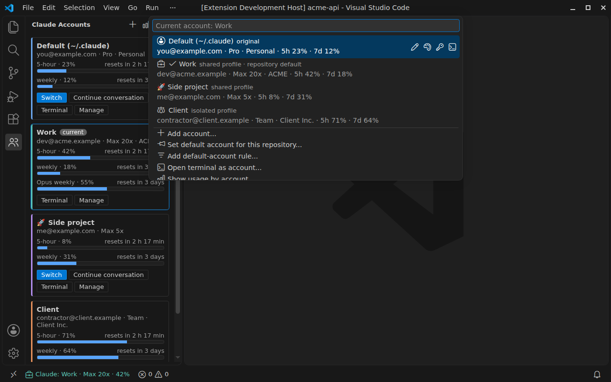
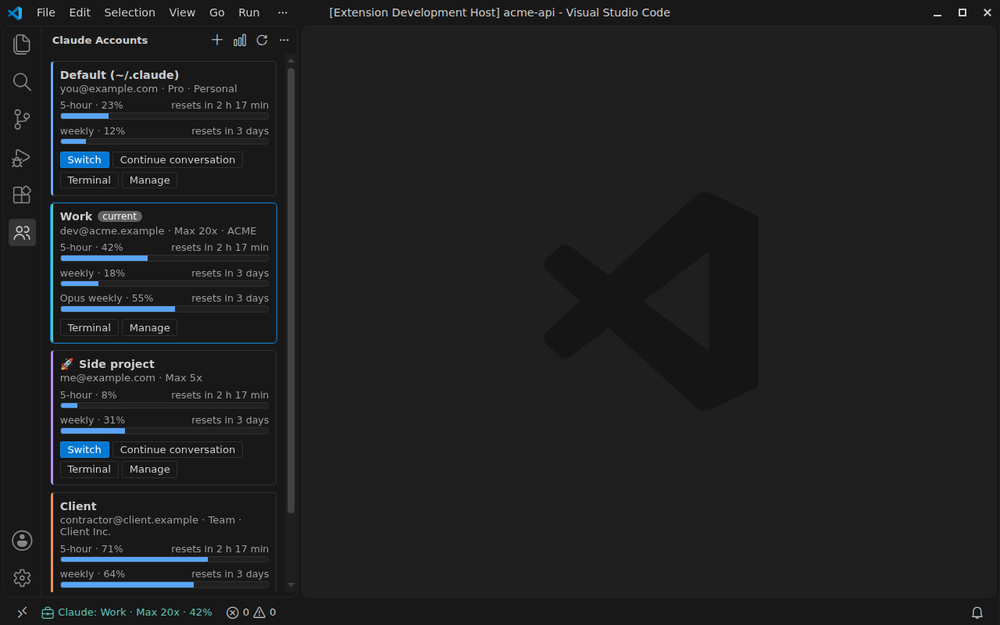
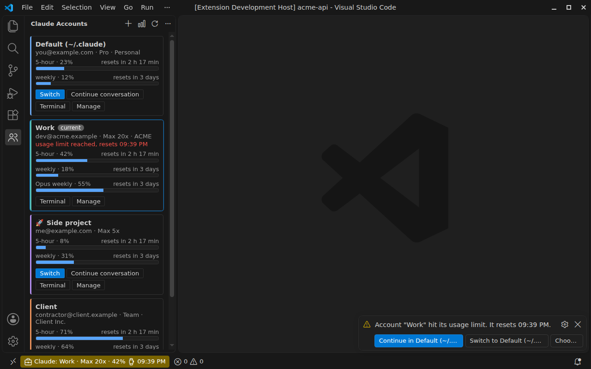

# Multi-Account Switcher for Claude Code

[](https://marketplace.visualstudio.com/items?itemName=kahuecosta.claude-code-multi-account)
[](https://marketplace.visualstudio.com/items?itemName=kahuecosta.claude-code-multi-account)
[](https://open-vsx.org/extension/kahuecosta/claude-code-multi-account)
[](https://github.com/Kahuecosta/account-switcher-for-claude-code/actions/workflows/ci.yml)
[](LICENSE)

Use várias contas do Claude Code no VS Code ao mesmo tempo: uma conta diferente **por janela ou por repositório**, o **plano e os limites de 5 horas e semanal** de cada conta à vista, e **um clique para continuar a conversa em outra conta** quando uma atinge o limite, sem recarregar a janela. A sua pasta `~/.claude` nunca é apagada nem sobrescrita.


> **Sem afiliação com a Anthropic.** Esta é uma extensão da comunidade. "Claude" e "Claude Code" são marcas registradas da Anthropic, PBC.

[English](README.md)

## Recursos

**Troca de conta**

- **Sem recarregar**: a troca muda na hora a conta do painel do Claude Code e dos novos chats, com as versões recentes da extensão do Claude Code (verificado automaticamente). As conversas já abertas mantêm a conta delas até você fechá-las.
- **Conta por janela**: cada janela do VS Code pode usar uma conta diferente ao mesmo tempo.
- **Padrão por repositório**: ao abrir um repositório, a conta dele é aplicada antes de o Claude Code iniciar. Clones do mesmo repositório compartilham o padrão, porque ele é identificado pelo remote do git.
- **Regras**: todos os repositórios em `~/trabalho/**`, ou todos de `github.com/minha-empresa/*`, usam uma conta.
- **Alternância rápida** entre as duas últimas contas com `Ctrl+Alt+Shift+A` (`Cmd+Alt+Shift+A` no macOS), pela barra de status ou pela view **Contas do Claude** na Activity Bar (também como lista no Explorer).
- **Contas por chat** (experimental, macOS, Linux e WSL): abra um novo chat do Claude Code com qualquer conta sem recarregar a janela; uma conversa retomada usa a conta a que pertence.
- **Terminais**: o `claude` da CLI nos terminais integrados usa a mesma conta do painel, e **Abrir terminal com a conta** roda a CLI com qualquer outra conta sem trocar a janela.

**Saber em qual conta você está**

- A view **Contas do Claude** na Activity Bar tem um cartão por conta: e-mail, plano, barras de 5 horas e semanal com o horário em que reiniciam, e botões para trocar, continuar a conversa nela ou abrir um terminal.
- Cada conta mostra **e-mail, plano** (ex.: Pro, Max 20x) e **organização**, além de **cor e ícone ou emoji** próprios na barra de status e uma imagem opcional no seletor.
- A barra de status mostra quando o painel do Claude Code ainda usa a conta anterior até a janela ser recarregada (quando a troca sem recarregar está desligada ou não é possível).
- **Diagnosticar** gera um relatório de qual conta cada parte do VS Code usa e roda `claude auth status` em todas as contas.

**Limites de uso**

- O **uso de 5 horas e semanal** de cada conta, além dos limites semanais por modelo e do uso extra quando o plano tem, lidos do que o Claude Code salva para cada conta, que a extensão pede para ele consultar de tempos em tempos: sem configuração e sem gastar nada do seu plano.
- Quando a conta atual atinge o limite de uso, ou passa de `claudeAccounts.quotaThreshold`, a extensão oferece **continuar a conversa na conta com mais cota sobrando** (ela abre numa nova aba com essa conta), ou só trocar para ela, e avisa quando o limite reinicia. Com `claudeAccounts.onUsageLimit: switch` ela faz isso sozinha: no limite, a conversa vai junto; perto dele, só a janela troca, já que a conversa pode ainda estar trabalhando.
- **Continuar a última conversa com outra conta** funciona a qualquer momento, com ou sem histórico compartilhado, no painel ou num terminal.
- **Uso por conta**: tokens usados hoje e nos últimos 7 dias, a partir dos logs locais do Claude Code.

**Perfis e histórico**

- **Perfil compartilhado**: reaproveita settings, `CLAUDE.md`, agents, commands, skills, rules, plugins e servidores MCP de escopo de usuário do `~/.claude`, e mantém só o próprio login. **Perfil isolado**: tudo separado.
- **Histórico compartilhado opcional**: todas as contas veem as mesmas conversas. Ao ligar, o histórico que cada conta já tem é mesclado; toda alteração é registrada e desfeita se algo falhar.

**Tipos de conta**

- Assinatura do Claude (login no claude.ai), token de longa duração da assinatura (`claude setup-token`), chave de API da Anthropic, Amazon Bedrock e Google Vertex AI. Chaves e tokens ficam no armazenamento seguro do VS Code.

**Seguro por padrão**

- O seu `~/.claude` original é a conta **Padrão** e nunca é apagado nem sobrescrito. Dados de login nunca são ligados entre contas, independentemente das configurações.
- Sem telemetria. Sem acesso à rede, exceto o Gravatar, se você ligar.
- O Settings Sync leva nomes, cores, ícones e padrões por repositório para as suas outras máquinas; pastas, logins e variáveis de ambiente ficam locais.

## Capturas de tela

| Seletor de contas | View Contas do Claude e barra de status | Limite de uso atingido |
| --- | --- | --- |
| [](images/screenshots/account-picker.png) | [](images/screenshots/accounts-view.png) | [](images/screenshots/usage-limit.png) |

_Dados de demonstração. Gere de novo com `npm run screenshots`._

## Instalação

- **VS Code**: instale o [Multi-Account Switcher for Claude Code](https://marketplace.visualstudio.com/items?itemName=kahuecosta.claude-code-multi-account) pelo Marketplace.
- **Cursor, VSCodium, Windsurf** e outros editores que usam o Open VSX: instale pelo [Open VSX](https://open-vsx.org/extension/kahuecosta/claude-code-multi-account).
- **Manualmente**: baixe o `.vsix` em [GitHub Releases](https://github.com/Kahuecosta/account-switcher-for-claude-code/releases) e rode **Extensions: Install from VSIX…**. Cada release tem um `SHA256SUMS.txt` e um atestado de procedência do build, que você confere com `gh attestation verify <arquivo>.vsix --repo Kahuecosta/account-switcher-for-claude-code`.

Requer VS Code 1.85 ou posterior. Funciona com a [extensão oficial do Claude Code](https://marketplace.visualstudio.com/items?itemName=anthropic.claude-code) e também só com a CLI `claude`.

## Como usar

1. Clique em **Claude: padrão** na barra de status e escolha **Adicionar conta…** (ou siga o walkthrough **Comece a usar várias contas do Claude Code**).
2. Dê um nome, escolha como ela faz login e selecione **Perfil compartilhado** ou **Perfil isolado**.
3. Escolha **Fazer login**. Um terminal abre só com o ambiente daquela conta e roda `claude auth login` (com a CLI que vem na extensão do Claude Code quando `claude` não está no seu PATH). A extensão percebe quando o login termina.
4. Troque de conta pela barra de status quando quiser. O painel do Claude Code acompanha na hora; com um Claude Code antigo, a janela é recarregada.
5. Opcional: **Definir conta padrão deste repositório…** ou **Adicionar regra de conta padrão…**.

Rode `/status` no Claude Code, ou **Contas do Claude: Diagnosticar**, para confirmar qual conta está ativa.

## Como funciona

O Claude Code lê a pasta de configuração da variável de ambiente `CLAUDE_CONFIG_DIR`. Cada conta é uma pasta em `~/.claude-accounts/` por padrão. Quando uma janela inicia, a extensão define `CLAUDE_CONFIG_DIR` (e as variáveis próprias da conta) no extension host daquela janela, de forma síncrona, antes de a extensão do Claude Code iniciar a CLI. Os terminais integrados recebem as mesmas variáveis pela API de variáveis de ambiente do VS Code; terminais abertos para outra conta recebem um ambiente completo próprio.

**Trocar sem recarregar.** A extensão do Claude Code inicia todo processo `claude` com o ambiente do extension host, lido de novo a cada início, então os novos chats seguem o `CLAUDE_CONFIG_DIR` assim que ele muda. A conta exibida, o estado de login e os caches também seguem quando ela confere de novo o `CLAUDE_CONFIG_DIR`, o que faz sempre que `claudeCode.environmentVariables` muda. Por isso, depois de uma troca, a extensão adiciona uma entrada nessa configuração e a remove em seguida; a configuração termina exatamente como estava, e nas outras janelas o Claude Code não encontra mudança. Antes disso, a extensão confere se o Claude Code instalado tem esse comportamento (as versões recentes têm); se não tiver, ou com `claudeAccounts.switchWithoutReload` desligado, a janela recarrega como antes e a barra de status mostra um ícone de sincronização até lá. Um teste contra a extensão real do Claude Code roda toda semana no CI para perceber uma versão que mude isso.

As conversas já abertas mantêm o processo `claude` delas, e portanto a conta, até serem fechadas: um processo em execução não troca de conta. Por isso **Continuar em…** abre a conversa numa nova aba, a partir de uma cópia com um novo id de sessão (como o `--fork-session` do próprio Claude Code); a aba que você usava fica como estava.

Os itens compartilhados são links simbólicos. No Windows, pastas usam junções, que não exigem privilégio de administrador, e arquivos usam symlink ou, como alternativa, hard link. O repositório é identificado lendo a pasta `.git` diretamente; nenhum processo `git` é executado, o que é seguro em pastas não confiáveis.

## Limites de uso e cota

**Uso de todas as contas.** Sempre que o Claude Code consulta o uso de uma conta, ele salva a resposta no `.claude.json` dela. A extensão lê isso (só quando o arquivo muda) e mostra as janelas de 5 horas e semanal, os limites semanais por modelo e o uso extra na barra de status, no seletor e na view **Contas do Claude**. O Claude Code faz essa consulta quando o painel dele inicia e quando você pede `/usage`, mas não durante uma conversa; por isso a extensão também pede: a cada 5 minutos enquanto você usa a janela (`claudeAccounts.usageCheckMinutes`) e quando você atualiza a view, ou uma conta só, com o botão no cartão dela. Uma conta esgotada não é consultada sozinha até reiniciar. Em cada consulta, ela inicia o binário `claude` com cada conta por alguns segundos, sem hooks, ferramentas nem servidores MCP, pede o uso e não envia nenhuma mensagem, então nada do plano é gasto e nenhuma conversa fica salva. Uma resposta salva para outro login, diferente do que está na pasta agora, é ignorada, e uma leitura com mais de 15 minutos diz de quando é.

**O que os números dizem.** A barra semanal informa quando acaba **neste ritmo** (a média dela); `claudeAccounts.forecast` inclui a de 5 horas (os últimos 45 minutos) ou desliga. Com `claudeAccounts.usageBreakdown`, **O que gastou** em cada cartão lista os projetos ou as conversas que levaram a maior parte de cada janela e quanto cada resposta delas precisa ler: partes do que este computador usou com aquela conta, estimadas pelos logs de sessão locais. Quando uma conversa da janela passa de `claudeAccounts.heavyConversationTokens`, a extensão avisa, já que `/compact` ou uma conversa nova faz o plano durar mais. `claudeAccounts.statusBarUsage` mostra as duas janelas, de uma ou de todas as contas, na barra de status.

**Atingir um limite.** A extensão acompanha os logs de sessão desta janela (na pasta `projects/` da conta). Quando o Claude Code informa um limite de uso, ou uma leitura dos últimos 15 minutos passa de `claudeAccounts.quotaThreshold` (95% por padrão), ela registra o limite para todas as janelas, oferece a melhor outra conta (logada, sem limite, com menos uso) e avisa quando o limite reinicia. Com o uso extra ligado, o limiar continua valendo: outra assinatura com cota sobrando vem antes do uso pago (defina o limiar como `0` para seguir usando o uso extra).

**Continuar a conversa.** **Continuar em…** copia a conversa (com os arquivos de subagentes e os checkpoints) para a outra conta e troca: pela notificação de limite, exatamente a conversa que atingiu o limite; pela view **Contas do Claude** ou pelo comando, a última conversa das pastas desta janela. Sem recarregar, a cópia recebe um novo id de sessão e abre numa nova aba com a outra conta; a aba que você usava continua rodando como antes. Quando a janela precisa recarregar, a cópia mantém o id e a conversa reabre depois que a janela recarrega, copiada de novo nesse momento para levar também as mensagens escritas antes do recarregamento. Uma cópia na outra conta só é substituída por outra que a continua; se a conversa seguiu nas duas contas, uma nova cópia é feita, para nenhuma mensagem se perder. **Continuar a última conversa no terminal com a conta** abre num terminal uma cópia com um novo id de sessão (`claude --resume`), para nunca rodar a mesma conversa que uma aba do Claude Code.

A **cota ao vivo** é opcional (**Contas do Claude: Ligar ou desligar a cota ao vivo**) e só deixa as atualizações mais frequentes enquanto a CLI `claude` roda num terminal. O Claude Code informa os `rate_limits` das assinaturas Pro e Max à sua [linha de status](https://code.claude.com/docs/en/statusline). A extensão envolve o comando `statusLine` do `settings.json` com um pequeno script (em `~/.claude-accounts/.bridge/`) que salva essa entrada na pasta da conta e depois roda a sua própria linha de status, sem mudanças. Desligar restaura a sua linha de status.

## Contas por chat (experimental)

Com `claudeAccounts.perChatAccounts` ligado (ou na primeira vez que você usa **Novo chat com a conta**), a extensão define o `claudeCode.claudeProcessWrapper` da extensão do Claude Code como um pequeno inicializador (`~/.claude-accounts/.bridge/claude-accounts-wrapper.sh`). O Claude Code inicia todo processo `claude` por ele, e o inicializador só escolhe o `CLAUDE_CONFIG_DIR` antes de rodar o `claude` com os mesmos argumentos:

- **Novo chat com a conta** abre uma nova aba do Claude Code com aquela conta, sem recarregar a janela nem mexer nos outros chats.
- Uma **conversa retomada** (depois de recarregar, ou pelo histórico) usa a conta cuja cópia dela foi gravada por último. Com o histórico compartilhado todas as contas têm a mesma cópia, então uma conversa retomada usa a conta da janela.
- Todo o resto mantém a conta da janela.

Só contas que entram com o próprio login do claude.ai e não definem variáveis de ambiente próprias podem ser usadas num único chat: o inicializador consegue trocar a pasta, mas não fornecer uma chave ou um token. Um chat direcionado a outra conta nunca herda as variáveis da conta da janela (uma chave de API, por exemplo). Um wrapper que você já tinha continua rodando: o inicializador o chama no lugar do `claude`. Desligar a configuração restaura o valor anterior. Só no macOS, Linux e WSL (a extensão do Claude Code não consegue iniciar um script no Windows).

## Regras

As regras são verificadas em ordem quando o repositório não tem um padrão próprio:

```json
"claudeAccounts.rules": [
  { "pattern": "github.com/minha-empresa/*", "account": "trabalho" },
  { "pattern": "~/pessoal/**", "account": "eu@exemplo.com" }
]
```

Um padrão que começa com `~`, `/` ou letra de unidade é comparado com o caminho da pasta. Qualquer outro é comparado com o remote do git. `*` vale para um nível e `**` para qualquer profundidade. Um padrão sem curingas também vale para tudo abaixo dele. `account` aceita o id da conta (nome da pasta), o nome ou o e-mail.

Numa janela com várias pastas, vence a primeira pasta que tiver padrão de repositório e, depois, a primeira que corresponder a uma regra; o tooltip lista as pastas que preferem outra conta.

## Automação

Associe um atalho a uma conta específica:

```json
{ "key": "ctrl+alt+1", "command": "claudeAccounts.switch", "args": "trabalho" }
```

Todo comando por conta (`switch`, `login`, `openTerminal`, `rename`, `remove`…) aceita como argumento o id, o nome ou o e-mail da conta. Links no formato `vscode://kahuecosta.claude-code-multi-account/switch?account=trabalho` (também `openTerminal`, `diagnose`, `add`) sempre pedem confirmação.

Outras extensões podem usar a API:

```js
const api = vscode.extensions.getExtension('kahuecosta.claude-code-multi-account')?.exports;
api?.getCurrentAccount(); // { id, name, email, plan, organization, configDir, mode, kind, isDefault }
api?.onDidChangeAccount((conta) => console.log(conta.name));
await api?.switchAccount('trabalho');
```

## Desenvolvimento remoto

A extensão roda onde o Claude Code roda: na máquina remota, no Remote-SSH, WSL, Dev Containers e Codespaces. Contas, logins e `~/.claude-accounts` ficam nessa máquina, então adicione as contas e faça login uma vez em cada máquina remota. O Settings Sync continua levando nomes, cores e padrões por repositório.

## Configurações

<!-- settings:start -->
| Configuração | Padrão | Descrição |
| --- | --- | --- |
| `claudeAccounts.scope` | `"workspace"` | Onde a conta selecionada fica guardada. `workspace`: Cada janela/repositório lembra a própria conta (armazenamento da extensão; nada é gravado no repositório). `user`: Uma única conta para todas as janelas (cada janela a adota quando recebe o foco). |
| `claudeAccounts.switchWithoutReload` | `true` | Trocar sem recarregar a janela quando a extensão do Claude Code instalada permite: a conta do painel e os novos chats mudam na hora. As conversas já abertas mantêm a conta delas até você fechá-las ou recarregar. Para avisar o Claude Code, a extensão adiciona uma entrada em `claudeCode.environmentVariables` e a remove em seguida. |
| `claudeAccounts.reloadBehavior` | `"ask"` | O que fazer depois de trocar quando a janela precisa recarregar (a troca sem recarregar está desligada ou não é possível). `ask`: Perguntar se deve recarregar a janela. `always`: Recarregar a janela na hora. `never`: Não recarregar; a barra de status mostra que há um recarregamento pendente. |
| `claudeAccounts.autoApplyRepoDefault` | `true` | Ao abrir um repositório, aplicar automaticamente a conta padrão definida para ele ou encontrada por uma regra. |
| `claudeAccounts.rules` | `[]` | Regras de conta padrão, verificadas em ordem quando o repositório não tem um padrão próprio. Um padrão que começa com `~`, `/` ou letra de unidade é comparado com o caminho da pasta (ex.: `~/trabalho/**`); qualquer outro é comparado com o remote do git (ex.: `github.com/minha-empresa/*`). Sem curingas, o padrão também vale para tudo abaixo dele. `account` é o id, o nome ou o e-mail da conta. Adicionar uma regra |
| `claudeAccounts.statusBarStyle` | `"name"` | Como a conta atual aparece na barra de status. `name`: Ícone e nome completo, ex.: Claude: Trabalho. `initials`: Ícone e iniciais, ex.: TR. `icon`: Só o ícone (mais compacto). |
| `claudeAccounts.showPlan` | `true` | Mostrar o plano da conta (ex.: Pro, Max 20x) na barra de status e no seletor de contas, quando o Claude Code informa. |
| `claudeAccounts.showQuota` | `true` | Mostrar na barra de status o uso da janela de limite atual. |
| `claudeAccounts.statusBarUsage` | `"window"` | O que a barra de status mostra do uso do plano (com `claudeAccounts.showQuota` ligado). `window`: Da conta atual, a janela mais perto do limite. `both`: Da conta atual, as janelas de 5 horas e semanal. `all`: As janelas de 5 horas e semanal de todas as contas (a atual e até mais quatro). |
| `claudeAccounts.showOrganization` | `true` | Mostrar a organização de cada conta. |
| `claudeAccounts.forecast` | `"weekly"` | Mostrar quando cada janela de uso acaba no ritmo dela, ou que dura até reiniciar. `off`: Não mostrar. `weekly`: Apenas na janela semanal. `both`: Nas janelas de 5 horas e semanal. |
| `claudeAccounts.usageBreakdown` | `"off"` | Mostrar o que gastou as janelas de 5 horas e semanal de cada conta (uma estimativa a partir dos logs de sessão locais). `off`: Não mostrar nem calcular. `project`: Por projeto: apenas nomes de pastas. `conversation`: Por conversa: com o título e quanto cada resposta precisa ler. |
| `claudeAccounts.onUsageLimit` | `"suggest"` | O que fazer quando a conta atual atinge o limite de uso nesta janela, ou passa de claudeAccounts.quotaThreshold. `suggest`: Oferecer continuar a conversa na conta com mais cota sobrando, ou trocar para ela. `switch`: Fazer isso sozinha: no limite, a conversa continua na conta com mais cota sobrando; perto dele, só a janela troca. `ignore`: Não fazer nada. |
| `claudeAccounts.liveQuota` | `false` | Ler o uso também da entrada da linha de status do Claude Code, para atualizações mais frequentes enquanto o CLI `claude` roda num terminal. O uso é sempre lido do que o Claude Code salva no `.claude.json` de cada conta; isto acrescenta uma segunda fonte. A extensão envolve o comando `statusLine` do `settings.json` com um script que salva essa entrada e depois roda a sua própria linha de status, sem mudanças; desligar restaura o original. Use Ligar ou desligar a cota ao vivo. |
| `claudeAccounts.quotaThreshold` | `95` | Considerar que a conta chegou ao limite quando o uso de 5 horas ou semanal atingir esta porcentagem, para trocar antes de o Claude Code recusar pedidos. `0` desliga. |
| `claudeAccounts.usageCheckMinutes` | `5` | De quantos em quantos minutos pedir ao Claude Code que verifique o uso do plano de cada conta conectada enquanto você usa a janela, para os números ficarem atualizados. Cada verificação inicia o binário `claude` em segundo plano por alguns segundos, com aquela conta; nenhuma mensagem é enviada, então nada do seu plano é gasto. `0` verifica apenas quando você atualiza as contas. |
| `claudeAccounts.heavyConversationTokens` | `300000` | Avisar quando cada resposta de uma conversa precisa reler pelo menos esta quantidade de tokens, o que gasta o plano mais rápido que o próprio trabalho. `0` desliga. |
| `claudeAccounts.shareHistory` | `false` | Todas as contas usam o mesmo histórico de conversas do `~/.claude`. Use Compartilhar histórico entre contas para ligar ou desligar: o histórico existente é mesclado, não descartado. |
| `claudeAccounts.historyItems` | `projects`, `history.jsonl`, `file-history`, `todos`, `plans` | Itens tratados como histórico: conversas por pasta (projects), histórico de prompts (history.jsonl), checkpoints (file-history), todos e planos. |
| `claudeAccounts.sharedItemsMode` | `"list"` | Quais itens do ~/.claude as contas de perfil compartilhado usam por meio de links. `list`: Só os itens de claudeAccounts.sharedItems. `allExcept`: Todos os itens do ~/.claude, exceto dados de login, histórico, estado de sessão e claudeAccounts.sharedItemsExclude. Pastas novas de configuração passam a ser compartilhadas sem mudar as configurações. |
| `claudeAccounts.sharedItems` | `settings.json`, `CLAUDE.md`, `agents`, `commands`, `skills`, `hooks`, `output-styles`, `plugins`, `rules`, `workflows`, `keybindings.json`, `themes` | Itens do `~/.claude` que as contas de perfil compartilhado usam por meio de links. Dados de login (`.credentials.json`, `.claude.json`) e estado de sessão nunca são compartilhados, independentemente desta lista. |
| `claudeAccounts.sharedItemsExclude` | `[]` | Itens que nunca são compartilhados no modo `allExcept` de `claudeAccounts.sharedItemsMode`. |
| `claudeAccounts.shareMcpServers` | `true` | Copiar os servidores MCP de escopo de usuário (do `.claude.json` da conta Padrão) para as contas de perfil compartilhado. Os servidores que a própria conta define são mantidos. Adicione servidores novos na conta Padrão. |
| `claudeAccounts.perChatAccounts` | `false` | Experimental. Cada chat do Claude Code pode usar a sua própria conta sem recarregar a janela: **Novo chat com a conta** abre um chat com qualquer conta, e uma conversa retomada usa a conta a que pertence. Define `claudeCode.claudeProcessWrapper` como um pequeno inicializador (apenas macOS, Linux e WSL); desligar restaura o valor anterior. |
| `claudeAccounts.applyToTerminal` | `true` | Aplicar a conta também nos terminais integrados desta janela, para o CLI claude usar a mesma conta. |
| `claudeAccounts.loginCommand` | `"claude auth login"` | Comando executado no terminal para fazer login em uma conta. |
| `claudeAccounts.accountsRoot` | — | Pasta onde as contas são criadas. Vazio = ~/.claude-accounts. |
| `claudeAccounts.gravatar` | `false` | Mostrar o Gravatar do e-mail de cada conta no seletor de contas. Vem desligado: quando ligado, a extensão pede imagens ao gravatar.com, enviando um hash do e-mail. |
| `claudeAccounts.suggestSwitchOnLimit` | `true` | Obsoleta. Substituída por `claudeAccounts.onUsageLimit`. |
<!-- settings:end -->

## Onde cada coisa fica

| O quê | Onde | Sincronizado |
| --- | --- | --- |
| Pastas das contas (login, histórico, configuração) | `~/.claude-accounts/<id>/` (`claudeAccounts.accountsRoot`) | Não |
| Conta Padrão | `~/.claude` e `~/.claude.json`, ou o `CLAUDE_CONFIG_DIR` com que o VS Code foi aberto | Não |
| Nomes, cores, ícones, padrões por repositório | Armazenamento global do VS Code | Settings Sync |
| Variáveis de ambiente | Armazenamento global do VS Code; valores secretos no armazenamento seguro do VS Code | Não |
| Conta selecionada | Armazenamento do workspace (ou global, com `claudeAccounts.scope: user`) | Não |
| Backups de histórico mesclado e de arquivos substituídos | `~/.claude-accounts/.backups/` (últimas 10 operações) | Não |
| Ponte da cota ao vivo | `~/.claude-accounts/.bridge/` e `.multi-account-statusline.json` na pasta de cada conta | Não |
| Inicializador das contas por chat | `~/.claude-accounts/.bridge/` (`claude-accounts-wrapper.sh`, `accounts.list`, `route/`) | Não |
| Log | **Contas do Claude: Mostrar log** | Não |

## Privacidade e segurança

- **Sem telemetria.** A única requisição de rede que a extensão pode fazer é ao gravatar.com, e só se você ligar `claudeAccounts.gravatar` (ela envia um hash SHA-256 do e-mail). As consultas de uso (`claudeAccounts.usageCheckMinutes`) são feitas pelo próprio Claude Code, com o login de cada conta.
- Fora das próprias pastas, a extensão só altera: o `~/.claude` quando você liga o histórico compartilhado (o histórico de cada conta é mesclado nele, com backups em `~/.claude-accounts/.backups/`); o `statusLine` do `settings.json` com a cota ao vivo ligada; o `claudeCode.claudeProcessWrapper` com as contas por chat ligadas; e, por um instante a cada troca sem recarregar, o `claudeCode.environmentVariables` (uma entrada adicionada e removida). Desligar a cota ao vivo ou as contas por chat restaura o que elas mudaram; desligar o histórico compartilhado devolve a cada conta o próprio histórico (uma cópia do compartilhado, ou vazio, como você escolher) e mantém o histórico mesclado no `~/.claude`.
- Do arquivo de credenciais, a extensão lê **apenas** `subscriptionType` e `rateLimitTier`. Do `.claude.json`, lê só a conta (`oauthAccount`: e-mail, organização, plano) e o uso salvo (`cachedUsageUtilization`). Os tokens nunca são guardados, exibidos nem enviados a lugar algum.
- O pedido de avaliação aparece no máximo duas vezes, depois de uma semana e de algumas trocas, e só abre a página da extensão.
- Dados de login (`.credentials.json`, `.claude.json`) e estado de sessão nunca são compartilhados entre contas, mesmo que estejam em `claudeAccounts.sharedItems`.
- As configurações que mudam o que acontece com as suas pastas ou com as configurações do Claude Code (`shareHistory`, `rules`, `scope`, `liveQuota`, `switchWithoutReload`, `perChatAccounts`…) só podem ser definidas nas configurações de usuário, nunca pelo `.vscode/settings.json` de um repositório. No Modo Restrito, as configurações do workspace não podem mudar quando as contas são aplicadas.
- Relate vulnerabilidades de forma privada; veja o [SECURITY.md](SECURITY.md).

## Solução de problemas

- **O painel mostra a conta errada logo após abrir**: o painel do Claude Code foi restaurado antes de esta extensão ativar. A extensão avisa o painel na hora; as conversas que ele já tinha iniciado mantêm a conta de abertura até você fechá-las. Com um Claude Code antigo, recarregue a janela uma vez; a barra de status mostra um ícone de sincronização quando isso é necessário.
- **Todas as janelas usam a mesma conta**: `CLAUDE_CONFIG_DIR` está em `claudeCode.environmentVariables`. Essa configuração vale para todas as janelas; a extensão detecta isso e oferece remover só essa entrada.
- **macOS**: as credenciais ficam no Keychain, uma entrada por pasta de conta. O **Diagnosticar** roda `claude auth status` em cada conta para confirmar que os logins estão separados.
- **Um item compartilhado parou de sincronizar**: alguma ferramenta substituiu o link por uma cópia. A extensão detecta isso e oferece **Religar**, guardando a versão local como `.bak-<data>`.
- **Os chats de uma conta não aparecem na outra**: o perfil compartilhado e o **Religar** compartilham só a configuração; cada conta mantém o próprio histórico. Rode **Contas do Claude: Compartilhar / parar de compartilhar histórico entre contas** para compartilhar as conversas e depois recarregue a janela. O painel do Claude Code lista as conversas anteriores a partir da pasta `projects` da conta, que é o que o compartilhamento de histórico liga.
- **A janela ainda recarrega ao trocar**: o **Diagnosticar** diz o motivo em "Switch without reloading": `claudeAccounts.switchWithoutReload` está desligado, `CLAUDE_CONFIG_DIR` está em `claudeCode.environmentVariables`, ou o Claude Code instalado não tem suporte (atualize-o).
- **Uma conversa aberta ainda usa a conta anterior**: uma conversa em execução mantém a conta dela. Feche a aba e abra de novo pelo histórico (com histórico compartilhado), use **Continuar em…**, ou recarregue a janela para mover todas as conversas abertas.
- **Uma conta sem números de uso**: eles aparecem quando o Claude Code consulta o uso daquela conta. Atualize a view **Contas do Claude**; se a conta não puder ser consultada, o log diz por quê.
- Qualquer outra coisa: rode **Contas do Claude: Diagnosticar**, veja **Contas do Claude: Mostrar log** e [abra uma issue](https://github.com/Kahuecosta/account-switcher-for-claude-code/issues/new/choose) com o relatório (os e-mails são mascarados).

## Limitações conhecidas

- Uma conversa já aberta mantém a conta até a aba ser fechada ou a janela recarregar; a troca vale para a conta do painel e os novos chats.
- A troca sem recarregar adiciona por um instante uma entrada em `claudeCode.environmentVariables` nas suas configurações de usuário e a remove, mantendo qualquer mudança feita nessa configuração nesse meio-tempo.
- As contas por chat são experimentais: **Novo chat com a conta** vale para o próximo chat novo que o painel iniciar naquela janela em até 30 segundos (se o Claude Code iniciar antes outro processo `claude` novo, é esse que recebe a conta); a conta exibida pelo próprio painel continua sendo a da janela; e com um process wrapper definido, o Claude Code inicia novos chats no modo de permissão padrão, a não ser que você escolha outro.
- Os números de uso são tão recentes quanto a última consulta do Claude Code para cada conta: cerca de `claudeAccounts.usageCheckMinutes` minutos, no máximo, enquanto você usa a janela.
- As variáveis de ambiente por conta valem para todas as extensões de uma janela que usa a conta.
- Seus hooks ou scripts que fixam `~/.claude` continuam apontando para a conta Padrão. Use `$CLAUDE_CONFIG_DIR` neles.
- As contagens de tokens (**Mostrar uso por conta**) vêm só dos logs desta máquina e não podem ser separadas por conta com o histórico compartilhado.
- Os formatos de transcrição e de credenciais são internos do Claude Code e podem mudar; todos os campos são lidos de forma defensiva.

## Desinstalação

1. Desligue antes a cota ao vivo e as contas por chat, se ligou, para a sua linha de status e o `claudeCode.claudeProcessWrapper` serem restaurados.
2. Opcional: desligue o histórico compartilhado para cada conta voltar a ter a própria cópia.
3. Desinstale a extensão. O `~/.claude` não é tocado; as pastas das contas ficam em `~/.claude-accounts/` até você apagá-las.

## Contribuindo

Contribuições são bem-vindas. Veja o [CONTRIBUTING.md](CONTRIBUTING.md) para o ambiente de desenvolvimento, testes e traduções, e o [docs/ARCHITECTURE.md](docs/ARCHITECTURE.md) para a organização do código.

## Licença

[MIT](LICENSE)
